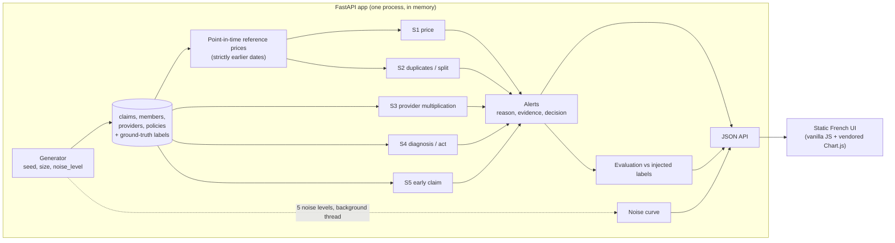

<!-- The block above is the Hugging Face Spaces configuration. GitHub shows it as a small table. -->

# Mutuelle Exemple: scenario-based fraud detection

[](https://github.com/SAAHMATHWORKS/mutuelle-exemple-fraude/actions/workflows/ci.yml)


A small, complete demo of **health-insurance fraud detection broken into scenarios**. It has five rule-based detectors, explanations a claims handler can read, a French web interface, and an honest evaluation. **Everything is synthetic**: the insurer "Mutuelle Exemple", its members, providers, codes and amounts are invented, and the fraud is injected by the generator.

**Assumptions** (stated instead of asked):
- **Domain.** A French-speaking health insurer that reimburses care acts: consultations, dental, optical, pharmacy, imaging, physiotherapy. One claim line is one billed act.
- **Period and size.** One observed year (2025) and about 20,000 claim lines. Fraud is about 5 % of lines, which is far more than in reality and keeps every scenario visible.
- **Data.** Codes, prices and the act/diagnosis rules table are invented and simplified. They do not follow any real nomenclature or tariff.
- **Shared state.** The app keeps one dataset in memory. "Regenerate" replaces it for every visitor, and it is rate limited.
- **Decision buttons.** They only store the choice in the viewer's browser.

## The problem

A claims handler cannot review 20,000 lines. They need a short queue in which every alert says *why* it exists and *what to do next*. Fraud is not one thing. Each scheme leaves a different trace in the data, so this demo uses one detector per scheme rather than one opaque score.

## The five scenarios

| # | Scenario | Trace in the data | Rule | Suggested decision |
|---|---|---|---|---|
| 1 | **Inflated price** | An act billed far above its usual price | Amount ≥ 2× the median price of the same act, computed **only from claims dated strictly before** (≥ 20 earlier lines). ≥ 3× gives high severity. | Ask for the detailed invoice. If the same provider already had ≥ 2 price alerts in 90 days, run a provider audit. |
| 2 | **Double or split billing** | Same member, provider and act repeated within 1 day, or one invoice cut into pieces | Cluster lines with the same member, provider and act ≤ 1 day apart. Pieces each < 75 % of the usual price that add up to about one usual price count as a split; anything else is a duplicate. Repeatable acts (pharmacy, physio) count only when billed the same day for the same amount. | Ask for the detailed invoice |
| 3 | **Provider multiplication** | One member sees many new doctors or pharmacies in a short time | ≥ 3 providers of the same type (GP, specialist, pharmacy) that the member had never used before, within 14 days | Medical review of the member |
| 4 | **Diagnosis / act incoherence** | An act unrelated to the diagnosis, for example glasses for back pain | A rules table lists the diagnosis groups that go with each act; anything outside it is flagged | Ask for medical justification, or no action below 25 € |
| 5 | **Very early claim** | A costly claim right after the policy starts | A costly act or ≥ 150 € within 30 days of the start date (high severity within 7 days) | Check the start date and the enrolment declaration |

Each alert carries a severity, a one-sentence reason in French, the evidence rows (flagged lines and context lines) and a suggested decision. There are no black-box models, only rules and simple statistics.

## Architecture



| Endpoint | Purpose |
|---|---|
| `GET /health` | Liveness and dataset size |
| `GET /api/overview` | Alerts per day and per scenario, headline numbers |
| `GET /api/alerts` | Queue with filters (`scenario`, `severity`, `decision`, `q`, `date_from`, `date_to`), sorting and pagination (≤ 100 per page) |
| `GET /api/alerts/{id}` | Full explanation, evidence rows, price chart data, ground truth (demo only) |
| `GET /api/exploration` | Exploratory aggregates: amount distribution, price spread per act, seasonality, daily volume, provider mix, Lorenz curves, age versus spend, and each scenario's signal split into legitimate lines and injected fraud |
| `GET /api/evaluation` | Per-scenario recall and precision, false alerts per day, alert volume per day, and the noise curve |
| `POST /api/regenerate` | New dataset: `seed`, `size` (2,000 to 50,000) and `noise_level` (0 to 1). Limited to 1 call per 15 s per client and 6 per minute overall. |

The code is organised as follows:
- `app/generator.py` builds the data.
- `app/detectors/` holds one module per scenario.
- `app/pipeline.py` runs the detectors and evaluates them.
- `app/exploration.py` computes the exploratory analysis shown in the "Exploration des données" view.
- `app/main.py` serves the API.
- `app/static/` holds the UI.

Startup takes about 2 seconds: about 1 s to generate the data and under 1 s to run the detectors.

## Run locally (3 commands)

Requires Python 3.12.

```bash
python3.12 -m venv .venv && . .venv/bin/activate
pip install -r requirements.txt
uvicorn app.main:app --port 7860
```

Open <http://localhost:7860>. With Docker, run `docker build -t fraude-demo . && docker run -p 7860:7860 fraude-demo`.

To run the tests and the linter:

```bash
pip install -r requirements-dev.txt
pytest
ruff check . && ruff format --check .
```

Every push runs the same checks on GitHub Actions (`.github/workflows/ci.yml`). The CI also starts the app and calls the API, then builds the Docker image and runs it read-only, as a non-root user, with 512 MB of memory and 1 CPU, until the Docker health check reports it healthy. Optional settings are listed in `.env.example`, and `CONTRIBUTING.md` gives the conventions.

## Deploy

### Hugging Face Spaces (Docker)

1. On huggingface.co, create a **New Space**: choose a name, set **SDK: Docker** with the *Blank* template, and pick the free CPU hardware.
2. Clone the Space: `git clone https://huggingface.co/spaces/<user>/<space-name>`.
3. Copy this project's files into the clone, keeping `README.md`. Its header tells Spaces to use Docker on port 7860.
4. Commit and push with `git add . && git commit -m "Deploy demo" && git push`. Git asks for your username and a **write access token** (from Settings → Access Tokens) as the password.
5. Watch the *Logs* tab. The Space is live when `/health` answers. The URL is `https://<user>-<space-name>.hf.space`.

### Render

1. Push this project to a GitHub repository.
2. On render.com, choose **New → Blueprint** and select the repository. Render reads `render.yaml`: one free web service built from the `Dockerfile`, with health check `/health`. (Or choose **New → Web Service**, pick the repository and set the runtime to **Docker**.)
3. Render sets `PORT` itself and the container listens on it. No environment variable is needed.
4. Wait for the first deploy. The app is at `https://<service-name>.onrender.com`. Free instances sleep when idle, so the first visit after a pause takes a little longer.

Optional environment variables change the dataset built at startup: `DEMO_SEED`, `DEMO_SIZE` and `DEMO_NOISE`.

## Exploration view

Before any rule, the **Exploration des données** page looks at the data the way a data scientist would. It has twelve charts, each with a one-line reading and a table view:

- **Portfolio (no labels used):** amount distribution, price spread per act (box plots on a log scale), seasonality by diagnosis group (small multiples), daily volume with a 7-day moving average, line share versus amount share by provider type, Lorenz curves and Gini index for providers and members, and age versus annual spend.
- **Signals (labels used):** for each scenario, the variable its rule thresholds, with legitimate lines and injected fraud each normalised to 100 %, and the rule's threshold drawn on the chart. The page states that this comparison is only possible because the fraud is synthetic.

## How it was evaluated

The generator records the true scenario of every line (0 means legitimate), so each detector can be scored exactly:
- **Recall:** the share of lines injected for a scenario that its detector flags.
- **Precision:** the share of lines flagged by a detector that truly belong to its scenario.
- **False alerts per day:** alerts in which no line is fraudulent, divided by 365.
- **Alert volume per day:** the handler's workload.

The legitimate data deliberately contains look-alikes:
- complex cases billed at a higher price;
- two teeth treated the same day;
- honest coding errors;
- people who need care right after joining;
- members who change doctor.

The evaluation page counts how many false alerts each of these causes.

Default dataset (seed 42, about 19,600 lines, noise 0.2):

| Scenario | Injected lines | Recall | Precision | False alerts / day |
|---|---:|---:|---:|---:|
| 1. Inflated price | 300 | 87 % | 71 % | 0.29 |
| 2. Double / split billing | 170 | 95 % | 68 % | 0.20 |
| 3. Provider multiplication | 198 | 96 % | 69 % | 0.05 |
| 4. Diagnosis / act incoherence | 170 | 81 % | 79 % | 0.10 |
| 5. Very early claim | 110 | 100 % | 78 % | 0.08 |
| **All rules** | 948 | **91 %** | **73 %** | **0.73** (2.5 alerts / day) |

`noise_level` makes the legitimate data messier and the fraud subtler. The fraud gets subtler through smaller price inflation, duplicates shifted by a few days, fewer providers spread over more days, plausible diagnosis codes, and longer waits after joining. Overall recall drops from 98 % at noise 0 to 42 % at noise 1, and false alerts rise from 0.4 to 2.2 per day. The price rule degrades most, from 97 % to 16 % recall, because a ×1.3 inflation hides inside normal price spread.

The tests prove three things:
- the generator is deterministic for a given seed;
- the price reference never uses a claim dated on or after the claim being scored (checked against a brute-force median, and by rewriting the future and showing that past scores do not change);
- each detector recovers at least 85 % of its own injected cases at low noise.

## Roadmap

The project is being extended in stages, each one tested before the next:

1. ~~Clean repository with CI~~ (done)
2. ~~"Exploration des données" view: distributions, seasonality, concentration and fraud-versus-legitimate charts~~ (done)
3. Deeper evaluation: precision-recall curves per threshold, confusion matrices, gain curve for the handler's queue
4. Provider heatmaps, a member–provider network graph, and an unsupervised model shown *only as a comparison* with the rules
5. Self-hosted deployment behind Nginx, isolated from other services on the same server

## Limits (please read)

- **The data is synthetic and the fraud was injected by me.** The scores measure how well the rules recover patterns I designed, not real-world accuracy. Each rule was written knowing what the injected fraud looks like, which is the most optimistic setting possible.
- Fraud is about 5 % of lines here, far more than in real portfolios. With realistic prevalence, precision would be much lower for the same rules.
- Thresholds (2×, 1 day, 14 days, 30 days, 150 €) were chosen by hand on this data, with no separate validation period.
- "New provider" and the price reference both depend on available history: early in the year, references are missing and every provider looks new.
- The rules are independent. There is no combined score, no link analysis between members and providers, and no learning from handler decisions.
- The decision buttons are not a workflow: nothing is saved on the server.

The **Évaluation** page repeats these weaknesses rule by rule in a box titled "Ce qui ne marche pas".

## Résumé en français

Démo de **détection de fraude santé par scénarios** pour un assureur fictif, « Mutuelle Exemple ». Les données sont **entièrement synthétiques**. Un générateur déterministe produit environ 20 000 lignes de soins et y injecte cinq scénarios :
1. prix gonflé ;
2. doublon ou facture fractionnée ;
3. multiplication des prestataires ;
4. incohérence entre diagnostic et acte ;
5. sinistre juste après l'adhésion.

Une règle par scénario lève des alertes. Chacune explique en une phrase pourquoi elle a été levée, montre les lignes concernées et propose une décision au gestionnaire. Le prix de référence n'utilise que des factures antérieures, et un test le prouve.

L'interface en français propose cinq vues :
- une vue d'ensemble ;
- une exploration des données en douze graphiques (distribution des montants, dispersion des prix, saisonnalité, concentration, et pour chaque scénario la variable sur laquelle porte la règle) ;
- la file d'alertes ;
- le détail d'une alerte ;
- une évaluation honnête : rappel, précision, fausses alertes par jour, effet du bruit, et un encadré « Ce qui ne marche pas ».

**Limite principale :** les fraudes ont été injectées par l'auteur. Les scores mesurent donc la capacité à retrouver ces motifs, pas la performance sur de vraies fraudes.

## Licence

MIT, see `LICENSE`. Chart.js is vendored under its own MIT licence.
