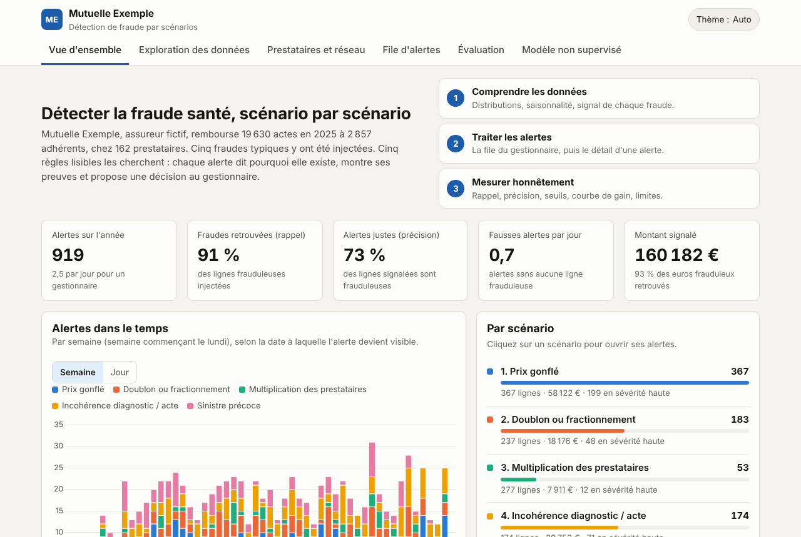
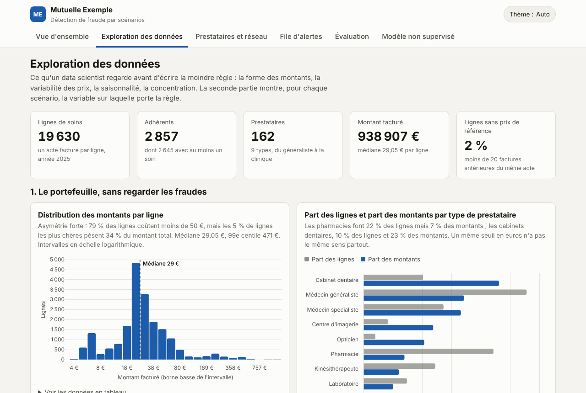
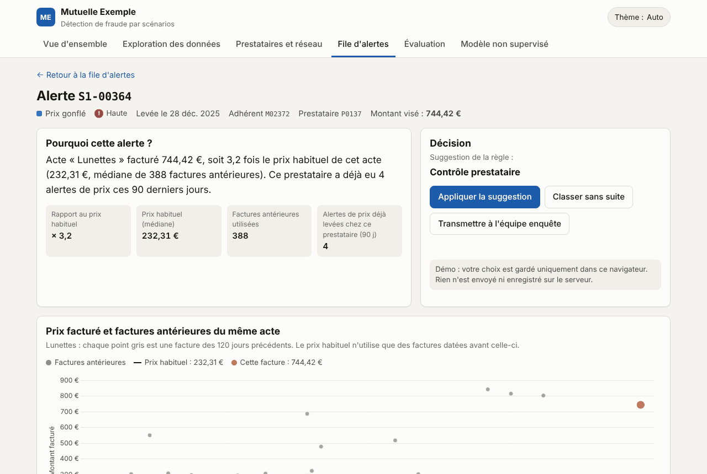
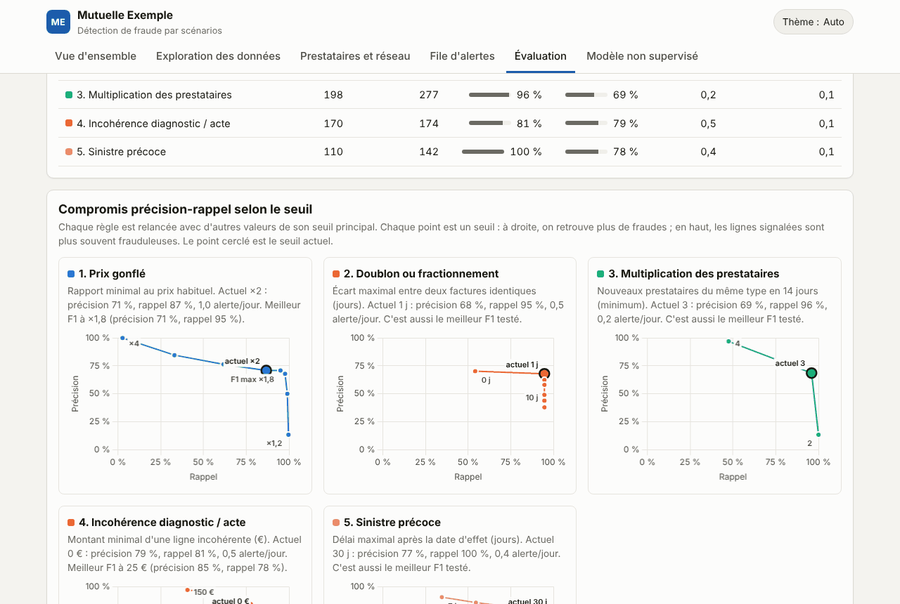
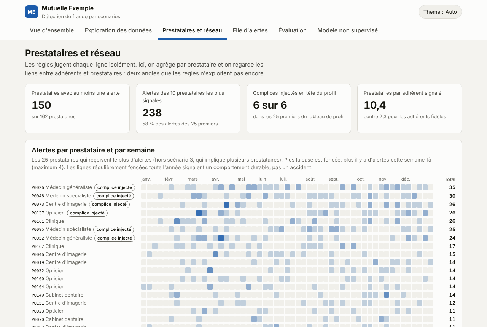
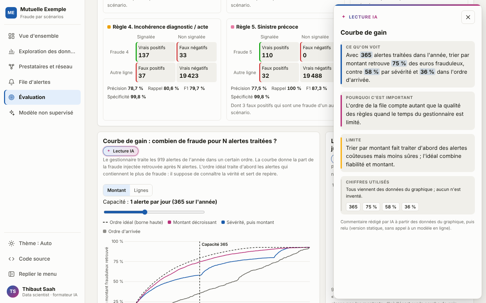
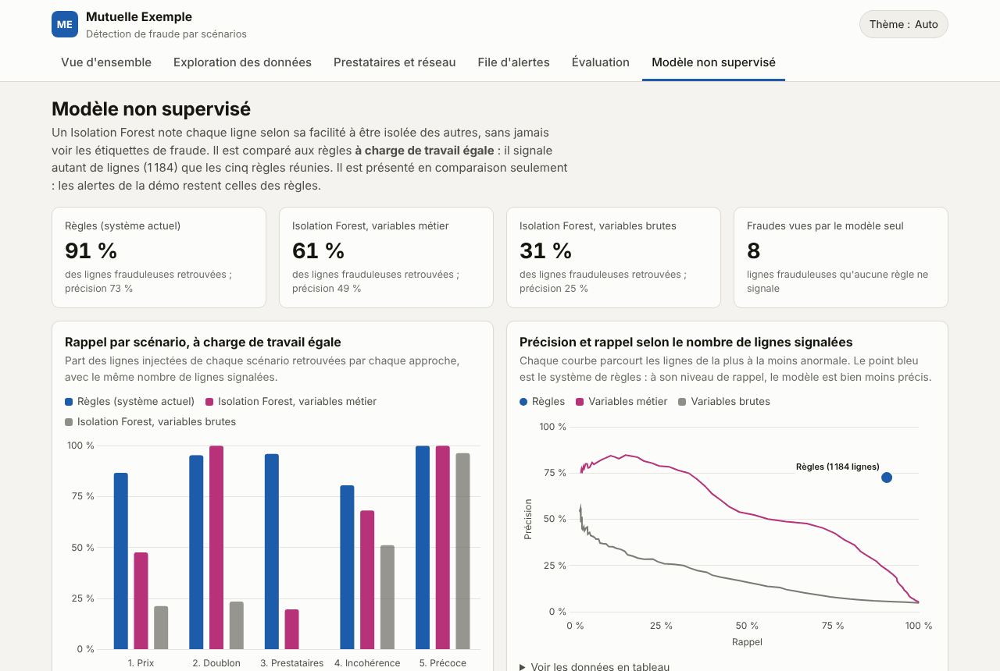
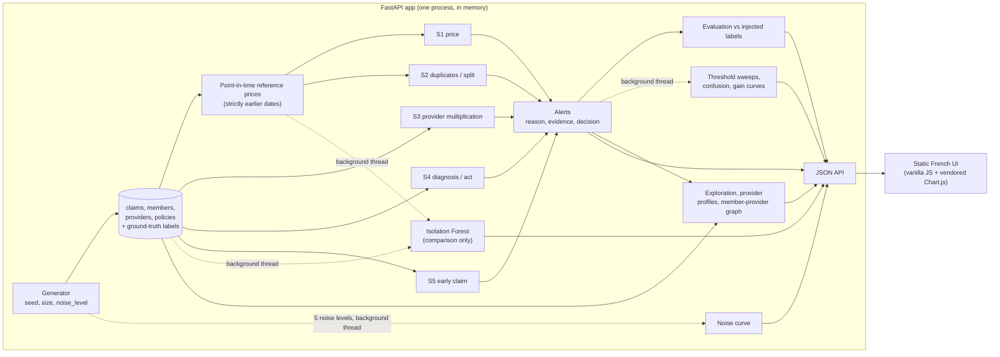

<!-- The block above is the Hugging Face Spaces configuration. GitHub shows it as a small table. -->

# Mutuelle Exemple: scenario-based fraud detection

[](https://github.com/SAAHMATHWORKS/mutuelle-exemple-fraude/actions/workflows/ci.yml)


**Live demo: <https://demo-fraude.kbc-sarl.com>** (French interface, read-only showcase mode).



A small, complete demo of **health-insurance fraud detection broken into scenarios**. It has five rule-based detectors, explanations a claims handler can read, a French web interface, and an honest evaluation. **Everything is synthetic**: the insurer "Mutuelle Exemple", its members, providers, codes and amounts are invented, and the fraud is injected by the generator.

**Assumptions** (stated instead of asked):
- **Domain.** A French-speaking health insurer that reimburses care acts: consultations, dental, optical, pharmacy, imaging, physiotherapy. One claim line is one billed act.
- **Period and size.** One observed year (2025) and about 20,000 claim lines. Fraud is about 5 % of lines, which is far more than in reality and keeps every scenario visible.
- **Data.** Codes, prices and the act/diagnosis rules table are invented and simplified. They do not follow any real nomenclature or tariff.
- **Shared state.** In live mode, the app keeps one dataset in memory: "Regenerate" replaces it for every visitor, and it is rate limited. The Docker image runs in showcase mode, where regeneration is off and every visitor sees the same precomputed demo.
- **Decision buttons.** They only store the choice in the viewer's browser.

## Screenshots

| | |
|---|---|
|  |  |
| **Exploration**: the data before any rule, then each scenario's signal | **Alert detail**: why, evidence rows, suggested decision |
|  |  |
| **Evaluation**: precision-recall per threshold, confusion matrices, gain curve | **Providers**: heat maps and member-provider graph |
|  |  |
| **Overview**: key figures, alerts over time; the sidebar folds to icons | **Lecture IA**: what the chart shows, why it matters, its limit, and every number it uses |
|  | |
| **Unsupervised model**: Isolation Forest compared with the rules at the same workload | |

## The problem

A claims handler cannot review 20,000 lines. They need a short queue in which every alert says *why* it exists and *what to do next*. Fraud is not one thing. Each scheme leaves a different trace in the data, so this demo uses one detector per scheme rather than one opaque score.

## The five scenarios

| # | Scenario | Trace in the data | Rule | Suggested decision |
|---|---|---|---|---|
| 1 | **Inflated price** | An act billed far above its usual price | Amount ≥ 2× the median price of the same act, computed **only from claims dated strictly before** (≥ 20 earlier lines). ≥ 3× gives high severity. | Ask for the detailed invoice. If the same provider already had ≥ 2 price alerts in 90 days, run a provider audit. |
| 2 | **Double or split billing** | Same member, provider and act repeated within 1 day, or one invoice cut into pieces | Cluster lines with the same member, provider and act ≤ 1 day apart. Pieces each < 75 % of the usual price that add up to about one usual price count as a split; anything else is a duplicate. Repeatable acts (pharmacy, physio) count only when billed the same day for the same amount. | Ask for the detailed invoice |
| 3 | **Provider multiplication** | One member sees many new doctors or pharmacies in a short time | ≥ 3 providers of the same type (GP, specialist, pharmacy) that the member had never used before, within 14 days | Medical review of the member |
| 4 | **Diagnosis / act incoherence** | An act unrelated to the diagnosis, for example glasses for back pain | A rules table lists the diagnosis groups that go with each act; anything outside it is flagged | Ask for medical justification, or no action below 25 € |
| 5 | **Very early claim** | A costly claim right after the policy starts | A costly act or ≥ 150 € within 30 days of the start date (high severity within 7 days) | Check the start date and the enrolment declaration |

The overview page explains the same five rules in plain French (« Comment ça marche ? »). That text is built from the detectors' own constants (`app/rules_doc.py`), so it cannot drift from the code.

Each alert carries a severity, a one-sentence reason in French, the evidence rows (flagged lines and context lines) and a suggested decision. Alerts come only from rules and simple statistics; an unsupervised model is shown on a separate page, as a comparison.

## Architecture



| Endpoint | Purpose |
|---|---|
| `GET /health` | Liveness and dataset size |
| `GET /api/overview` | Alerts per day and per scenario, headline numbers |
| `GET /api/alerts` | Queue with filters (`scenario`, `severity`, `decision`, `q`, `date_from`, `date_to`), sorting and pagination (≤ 100 per page) |
| `GET /api/alerts/{id}` | Full explanation, evidence rows, price chart data, ground truth (demo only) |
| `GET /api/evaluation/advanced` | Threshold sweeps (precision and recall of each rule re-run with other thresholds), confusion matrices, gain curves and precision by severity. Computed in the background after each (re)generation; returns `{"status": "computing"}` until ready |
| `GET /api/providers` | Alerts per provider and week, provider billing profile, member-provider graph (layout computed server-side) |
| `GET /api/model` | Isolation Forest compared with the rules at the same workload. Computed in the background; `{"status": "computing"}` until ready |
| `GET /api/exploration` | Exploratory aggregates: amount distribution, price spread per act, seasonality, daily volume, provider mix, Lorenz curves, age versus spend, and each scenario's signal split into legitimate lines and injected fraud |
| `GET /api/evaluation` | Per-scenario recall and precision, false alerts per day, alert volume per day, and the noise curve |
| `POST /api/regenerate` | New dataset: `seed`, `size` (2,000 to 50,000) and `noise_level` (0 to 1). Limited to 1 call per 15 s per client and 6 per minute overall. |

The code is organised as follows:
- `app/generator.py` builds the data.
- `app/detectors/` holds one module per scenario.
- `app/pipeline.py` runs the detectors and evaluates them.
- `app/advanced_eval.py` computes the threshold sweeps, confusion matrices and gain curves.
- `app/providers.py` computes the provider heat maps and the member-provider graph.
- `app/model_compare.py` trains the Isolation Forest and compares it with the rules.
- `app/exploration.py` computes the exploratory analysis shown in the "Exploration des données" view.
- `app/main.py` serves the API.
- `app/static/` holds the UI.

Startup takes about 2 seconds: about 1 s to generate the data and under 1 s to run the detectors.

## Run locally (3 commands)

Requires Python 3.12.

```bash
python3.12 -m venv .venv && . .venv/bin/activate
pip install -r requirements.txt
uvicorn app.main:app --port 7860
```

Open <http://localhost:7860>. This is the **live mode**: regeneration works and the heavier views are computed in the background after each new dataset.

With Docker, `docker build -t fraude-demo . && docker run -p 7860:7860 fraude-demo` starts the **showcase mode** described below. Add `-e DEMO_SNAPSHOT=` to the `docker run` command for the live mode.

To run the tests and the linter:

```bash
pip install -r requirements-dev.txt
pytest
ruff check . && ruff format --check .
```

Every push runs the same checks on GitHub Actions (`.github/workflows/ci.yml`). The CI also starts the app and calls every endpoint. It checks the deployment files (`shellcheck`, `docker compose config`, and `nginx -t` on the filled Nginx template), builds the image, and runs it the way the server does: read-only, non-root, low priority. It then checks that every view is ready on the first call, that regeneration is refused, and that memory stays under 200 MiB. Optional settings are listed in `.env.example`, and `CONTRIBUTING.md` gives the conventions.

## Deploy

### Showcase mode (what the Docker image runs)

The image is built for small shared servers. During `docker build`, `python -m app.snapshot` generates the default dataset and computes **every view once**: alerts, exploration, provider analysis, threshold sweeps, Isolation Forest and noise curve. This takes about 20 s and 300 MB of RAM, at build time only. The container then loads that snapshot and serves it read-only:

- every page answers in a few milliseconds, with no "computing" state;
- about 110 MB of RAM, and scikit-learn is never loaded at run time;
- regeneration is turned off (`POST /api/regenerate` returns 403). Every visitor sees the same stable demo, and the interface says that regeneration works locally.

`GET /health` reports `"mode": "vitrine"` (showcase) or `"live"`.

### Self-hosted: Docker Compose behind Nginx and Cloudflare

`docker-compose.yml` runs the demo as its own compose project with its own network, published on `127.0.0.1:8020` only. It has no memory or CPU cap, so visitors are never throttled. Instead it gets a low priority: under memory pressure the kernel stops it first (`oom_score_adj`), and it yields CPU to other services (`cpu_shares`). The file system is read-only, capabilities are dropped and logs are bounded.

1. **Server, once:** clone the repository, then run `./deploy/deploy.sh`. The script pulls, builds while the current container keeps serving, restarts, waits for the health check and prunes old images. It refuses to run during a freeze window (default `2026-12-07:2026-12-11`, set with `DEMO_FREEZE`; override with `FORCE=1`).
2. **Server, once:** fill `deploy/nginx-site.conf.template` (domain, Cloudflare origin certificate and key), save it under `/etc/nginx/sites-available/`, link it into `sites-enabled`, then run `sudo nginx -t && sudo systemctl reload nginx`.
3. **DNS:** add a proxied record (orange cloud) for the domain, pointing to the server. Cloudflare's SSL mode must be *Full* or *Full (strict)*.
4. **Updates:** `./deploy/deploy.sh`.

### Hugging Face Spaces (Docker)

1. On huggingface.co, create a **New Space**: choose a name, set **SDK: Docker** with the *Blank* template, and pick the free CPU hardware.
2. Clone the Space: `git clone https://huggingface.co/spaces/<user>/<space-name>`.
3. Copy this project's files into the clone, keeping `README.md`. Its header tells Spaces to use Docker on port 7860.
4. Commit and push with `git add . && git commit -m "Deploy demo" && git push`. Git asks for your username and a **write access token** (from Settings → Access Tokens) as the password.
5. Watch the *Logs* tab. The Space is live when `/health` answers. The URL is `https://<user>-<space-name>.hf.space`.

### Render

1. Push this project to a GitHub repository.
2. On render.com, choose **New → Blueprint** and select the repository. Render reads `render.yaml`: one free web service built from the `Dockerfile`, with health check `/health`. (Or choose **New → Web Service**, pick the repository and set the runtime to **Docker**.)
3. Render sets `PORT` itself and the container listens on it. No environment variable is needed.
4. Wait for the first deploy. The app is at `https://<service-name>.onrender.com`. Free instances sleep when idle, so the first visit after a pause takes a little longer.

In live mode, optional environment variables change the dataset built at startup: `DEMO_SEED`, `DEMO_SIZE` and `DEMO_NOISE`. Hugging Face and Render build the same image, so they also run the showcase mode.

## Exploration view

Before any rule, the **Exploration des données** page looks at the data the way a data scientist would. It has twelve charts, each with a one-line reading and a table view:

- **Portfolio (no labels used):** amount distribution, price spread per act (box plots on a log scale), seasonality by diagnosis group (small multiples), daily volume with a 7-day moving average, line share versus amount share by provider type, Lorenz curves and Gini index for providers and members, and age versus annual spend.
- **Signals (labels used):** for each scenario, the variable its rule thresholds, with legitimate lines and injected fraud each normalised to 100 %, and the rule's threshold drawn on the chart. The page states that this comparison is only possible because the fraud is synthetic.

## How it was evaluated

The generator records the true scenario of every line (0 means legitimate), so each detector can be scored exactly:
- **Recall:** the share of lines injected for a scenario that its detector flags.
- **Precision:** the share of lines flagged by a detector that truly belong to its scenario.
- **False alerts per day:** alerts in which no line is fraudulent, divided by 365.
- **Alert volume per day:** the handler's workload.

The legitimate data deliberately contains look-alikes:
- complex cases billed at a higher price;
- two teeth treated the same day;
- honest coding errors;
- people who need care right after joining;
- members who change doctor.

The evaluation page counts how many false alerts each of these causes.

Default dataset (seed 42, about 19,600 lines, noise 0.2):

| Scenario | Injected lines | Recall | Precision | False alerts / day |
|---|---:|---:|---:|---:|
| 1. Inflated price | 300 | 87 % | 71 % | 0.29 |
| 2. Double / split billing | 170 | 95 % | 68 % | 0.20 |
| 3. Provider multiplication | 198 | 96 % | 69 % | 0.05 |
| 4. Diagnosis / act incoherence | 170 | 81 % | 79 % | 0.10 |
| 5. Very early claim | 110 | 100 % | 78 % | 0.08 |
| **All rules** | 948 | **91 %** | **73 %** | **0.73** (2.5 alerts / day) |

`noise_level` makes the legitimate data messier and the fraud subtler. The fraud gets subtler through smaller price inflation, duplicates shifted by a few days, fewer providers spread over more days, plausible diagnosis codes, and longer waits after joining. Overall recall drops from 98 % at noise 0 to 42 % at noise 1, and false alerts rise from 0.4 to 2.2 per day. The price rule degrades most, from 97 % to 16 % recall, because a ×1.3 inflation hides inside normal price spread.

The tests prove three things:
- the generator is deterministic for a given seed;
- the price reference never uses a claim dated on or after the claim being scored (checked against a brute-force median, and by rewriting the future and showing that past scores do not change);
- each detector recovers at least 85 % of its own injected cases at low noise.

### Deeper evaluation

The **Évaluation** page goes beyond one recall and one precision per rule:

- **Precision-recall trade-off per threshold.** Each rule is re-run with other values of its main threshold (for example ×1.2 to ×4 for the price rule). Its current threshold and the threshold with the best F1 are marked. On the default data, ×1.8 would raise the price rule's recall from 87 % to 95 % at the same precision. It is not adopted: choosing it on the same data would be overfitting.
- **Which rule catches which fraud.** A matrix of injected scenario × rule shows cross-detection and the fraud that no rule sees, plus a 2 × 2 confusion matrix, F1 and specificity per rule.
- **Gain curve.** It shows how much of the injected fraud a handler recovers after N alerts, depending on how the queue is sorted. With one alert a day (365 a year), sorting by amount recovers 75 % of the fraudulent euros, against 58 % for severity then amount and 36 % for arrival order.
- **Severity check.** 92 % of high-severity alerts are right, against 41 % of low-severity ones. Severity ranks reliability, not money.
- **Economic view (cost of risk).** Net value of the investigations = fraudulent euros recovered − handling cost of the alerts, as a function of how many alerts are handled. Both assumptions are sliders (illustrative defaults: 40 € per alert, 80 % of the detected fraud recovered). With these, handling the 527 most expensive alerts yields 74,200 € net, against 67,684 € when all 919 are handled: past that point, one more alert costs more than it brings back.

## Providers and network view

The rules judge each line on its own. The **Prestataires et réseau** page looks at two angles they do not use yet:

- **Alerts per provider and week** (heat map). A provider that is dark all year shows lasting behaviour, not an accident.
- **Billing profile per provider** (heat-map table, one colour scale per column): price level against the point-in-time reference, share of lines at 1.5× or more, alert rate. The generator routed part of the inflated prices through six "complicit" providers. Ranked by share of high prices, they take exactly the first six places, so aggregating per provider finds them, while the line-level rule only sees a series of separate alerts.
- **Member-provider graph** (layout computed with networkx). Flagged members see about ten providers once each; busy but loyal members see two or three providers about five times each. The generator injected no organised ring, and the page says so: on real data, this graph would be used to look for communities.

## Unsupervised model (comparison only)

The **Modèle non supervisé** page trains an Isolation Forest (scikit-learn, 200 trees) without labels and compares it with the rules **at the same workload**: it flags as many lines as the five rules together (1,184 on the default data).

| Approach | Recall | Precision |
|---|---:|---:|
| Rules (the system used for alerts) | 91 % | 73 % |
| Isolation Forest, domain features (the rules' signals, computed without labels) | 61 % | 49 % |
| Isolation Forest, raw features (amount, act rarity, age, provider volume, day) | 31 % | 25 % |

The jump from 31 % to 61 % comes from the features, not the algorithm. The model also finds 8 fraudulent lines that no rule flags. That makes it a useful discovery tool for new scenarios, but not a replacement: it gives a score, not a reason a claims handler can act on. It is trained on the whole year at once; a real deployment would train on the past and score the present.

## AI reading of the charts (« Lecture IA »)

Each of the 28 charts has a **✦ Lecture IA** button. It opens a side panel with three short parts written for a claims manager: what the chart shows, why it matters, and the limit to keep in mind, followed by the list of numbers the text uses.

- **Today: static, no API key.** The texts were written by an AI assistant as templates, reviewed, and filled with the chart's own data (`app/narratives.py`, served by `GET /api/explain`). They change when the data changes.
- **No invented figure.** `tests/test_narratives.py` removes every recorded fact from each text and fails if any digit is left, so a commentary can only quote numbers that come from the data.
- **Optional: written by a language model on the server** (`app/llm_explain.py`, `GET /api/explain/{chart_id}`). Set `LLM_PROVIDER` (`openai` for any OpenAI-compatible API, or `anthropic`), `LLM_API_KEY` and `LLM_MODEL` in the server's `.env` (see `.env.example`). The model only receives the chart title, its facts and the reviewed static reading. Every number in its answer must be one of those facts: otherwise it is retried once, then dropped for the static text. One call per chart and dataset (cached), a daily budget, a 24 s time limit per chart (retry included), and the static text whenever anything fails. The key stays on the server: never in the repository, the image, the browser or the logs. The panel says which version the reader sees.

**Accessibility.** Every text on every view meets the WCAG AA contrast ratio in the light and dark themes (checked with an automated audit of the rendered pages); each chart has a text description and most have a « Voir les données en tableau » table; controls are native buttons and links, and Escape closes the menu and the side panel.

## What I would do next

Each point follows from something the demo measured:

1. **Choose thresholds on one period and check them on the next.** The precision-recall sweep suggests ×1.8 rather than ×2 for prices, but picking it on the same data would be overfitting. A time split (for example, tune on January to September and validate on October to December) is the honest way to move it.
2. **Sort the queue by expected recovered amount, not by severity alone.** Severity ranks reliability well (92 % of high alerts are right), but sorting by amount recovers 75 % of the fraudulent euros in 365 alerts, against 58 %. A priority of reliability × amount would combine both.
3. **Turn the provider profile into a rule.** Aggregated per provider, the six providers that inflate prices come out first. A provider-level rule would catch them earlier than a series of line-level alerts.
4. **Learn from handler decisions.** Each confirmed or dismissed alert is a label. It can recalibrate severities and thresholds, watching for the feedback loop (only alerted lines ever get labels).
5. **Use the unsupervised model to discover, not to decide.** It finds frauds no rule sees. A monthly review of its most anomalous lines outside the alerts is a cheap source of new scenarios, each turned into an explainable rule.
6. **Look for organised groups on real data.** The member-provider graph is ready for community detection. The synthetic data has no organised ring, so this demo cannot show it.

## Limits (please read)

- **The data is synthetic and the fraud was injected by me.** The scores measure how well the rules recover patterns I designed, not real-world accuracy. Each rule was written knowing what the injected fraud looks like, which is the most optimistic setting possible.
- Fraud is about 5 % of lines here, far more than in real portfolios. With realistic prevalence, precision would be much lower for the same rules.
- Thresholds (2×, 1 day, 14 days, 30 days, 150 €) were chosen by hand on this data, with no separate validation period.
- "New provider" and the price reference both depend on available history: early in the year, references are missing and every provider looks new.
- The rules are independent. There is no combined score, no learning from handler decisions, and the provider profiles and member-provider graph are shown for analysis but not used by any rule.
- The decision buttons are not a workflow: nothing is saved on the server.

The **Évaluation** page repeats these weaknesses rule by rule in a box titled "Ce qui ne marche pas".

## Résumé en français

Démo de **détection de fraude santé par scénarios** pour un assureur fictif, « Mutuelle Exemple ». Démo en ligne : <https://demo-fraude.kbc-sarl.com>. Les données sont **entièrement synthétiques**. Un générateur déterministe produit environ 20 000 lignes de soins et y injecte cinq scénarios :
1. prix gonflé ;
2. doublon ou facture fractionnée ;
3. multiplication des prestataires ;
4. incohérence entre diagnostic et acte ;
5. sinistre juste après l'adhésion.

Une règle par scénario lève des alertes. Chacune explique en une phrase pourquoi elle a été levée, montre les lignes concernées et propose une décision au gestionnaire. Le prix de référence n'utilise que des factures antérieures, et un test le prouve.

L'interface en français propose sept vues :
- une vue d'ensemble ;
- les prestataires et le réseau : alertes par prestataire et par semaine, profil de facturation, graphe adhérents–prestataires ;
- un modèle non supervisé (Isolation Forest) comparé aux règles à charge de travail égale, en simple comparaison ;
- une exploration des données en douze graphiques (distribution des montants, dispersion des prix, saisonnalité, concentration, et pour chaque scénario la variable sur laquelle porte la règle) ;
- la file d'alertes ;
- le détail d'une alerte ;
- une évaluation honnête : rappel, précision, fausses alertes par jour, courbes précision-rappel selon le seuil, matrices de confusion, courbe de gain de la file d'alertes, effet du bruit, et un encadré « Ce qui ne marche pas ».

**Suite envisagée :** choisir les seuils sur une période et les valider sur la suivante ; trier la file selon le montant attendu et la fiabilité de l'alerte ; transformer le profil de facturation des prestataires en règle ; apprendre des décisions des gestionnaires ; utiliser le modèle non supervisé pour découvrir de nouveaux scénarios.

**Limite principale :** les fraudes ont été injectées par l'auteur. Les scores mesurent donc la capacité à retrouver ces motifs, pas la performance sur de vraies fraudes.

## Licence

MIT, see `LICENSE`. Chart.js is vendored under its own MIT licence.
